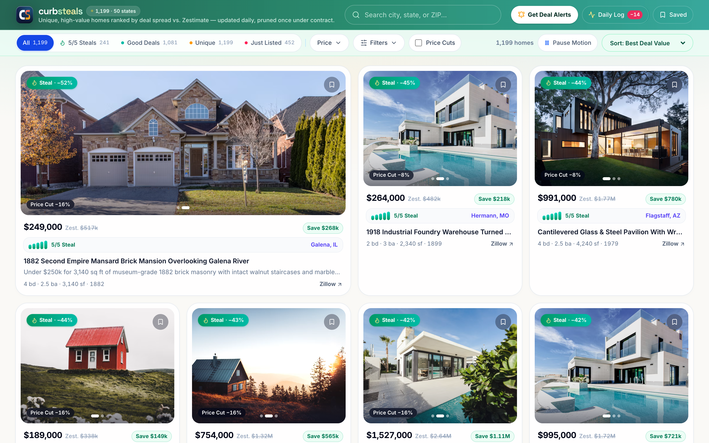
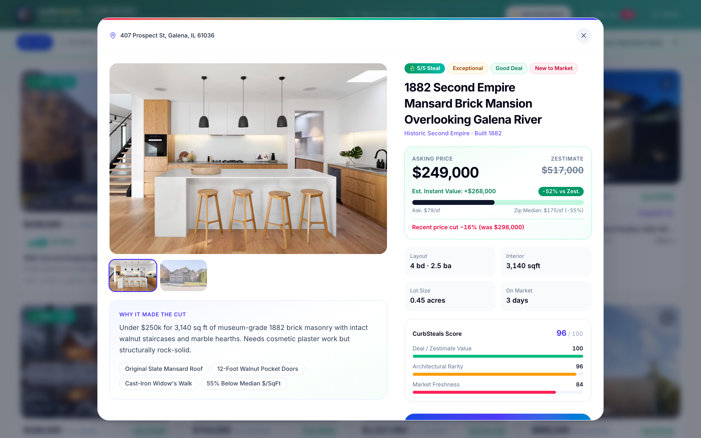
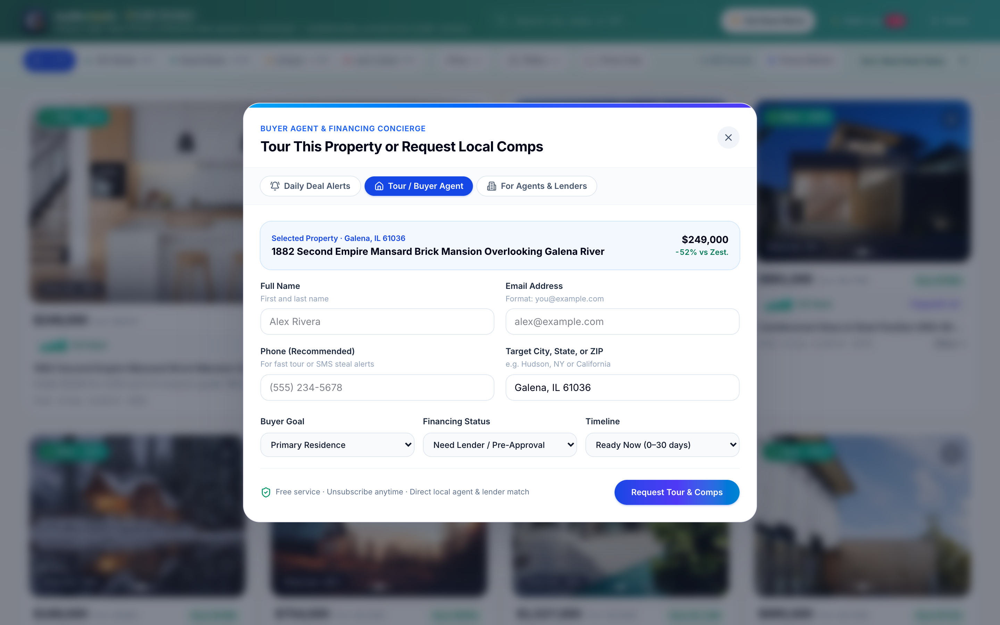
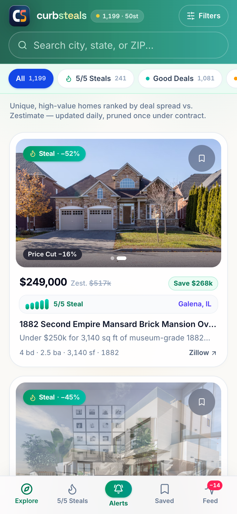
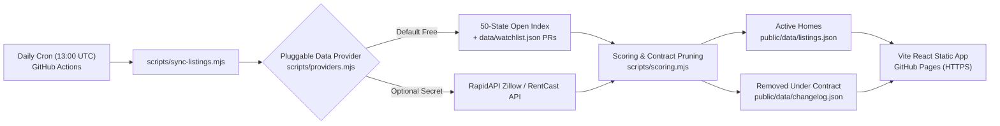

<div align="center">


# CurbSteals

**An open-source, zero-cost, self-updating real-estate discovery app surfacing unique, below-Zestimate homes across all 50 US states — updated daily and automatically pruned once under contract.**

[](https://curbsteals.com)
[](LICENSE)
[](https://curbsteals.com)
[](https://pages.github.com)

[Explore Live Demo](https://curbsteals.com) · [How It Works](#architecture--daily-automation) · [Deal Scale Explained](#the-5-tier-deal-scale) · [Lead Generation Setup](#lead-generation--revenue-capture) · [Contribute a Find](CONTRIBUTING.md)

</div>

---

## Screenshots

### Desktop Discovery Feed (1,199+ Homes Across All 50 States)
*Frosted emerald-teal glass header, live City/State/ZIP autocomplete search, 5-bar Deal Scale indicators, Asking Price vs. Zestimate savings, and staggered GPU-composited image transitions.*



### Property Dossier & Valuation Gauge
*Click any property to inspect its multi-photo gallery, Asking Price vs. Zestimate equity bar, $/sqft vs. ZIP median comparison, architectural rarity signals, and direct buyer-agent tour request.*



### Built-In Real-Estate Lead Capture & Mobile Experience

<table>
  <tr>
    <td width="64%" valign="top">
      <strong>3-Channel Lead Generation Modal</strong><br />
      <em>Buyer tour &amp; local agent referrals, daily 5/5 Steal alerts, and B2B agent/lender state sponsorships—zero backend required.</em><br /><br />
      
    </td>
    <td width="36%" valign="top">
      <strong>Native-Style Mobile Web App</strong><br />
      <em>Swipeable photo cards, unified sticky header, bottom-sheet filters, and fixed iOS/Android safe-area tab bar.</em><br /><br />
      
    </td>
  </tr>
</table>

---

## What Makes CurbSteals Different

- **Curated for Uniqueness + Value ("Zillow Gone Wild" Meets Deal Finder):** Surfaces architectural outliers (cantilevered glass pavilions, converted firehouses, historic mills, desert adobe compounds, coastal A-frames) ranked automatically by **Asking Price vs. Zestimate**.
- **Self-Cleaning Daily Index:** Every daily sync checks listing statuses. Homes that move to `PENDING`, `CONTINGENT`, `UNDER_CONTRACT`, or `SOLD` are automatically purged from the live catalog and archived in the **Contract Removal Log**.
- **All 50 US States, Instant Filtering:** Ships with `1,199+` active homes spanning all 50 states (`~178 KB` gzipped JSON), searchable in `< 5ms` by city, state name or code, ZIP code, price tier, bedrooms/bathrooms, square footage, architectural style, and Deal Scale rating.
- **100% Free Static Hosting:** Runs entirely on **GitHub Pages + GitHub Actions** with zero database or backend hosting bills, plus free Let's Encrypt HTTPS on a custom domain (`curbsteals.com`).
- **Interactive Demo Sandbox:** Click **Preview +1 Day Sync** in the UI to simulate tomorrow's automated run in real time—watching fresh finds drop in and older properties move to the Under-Contract archive.

---

## The 5-Tier Deal Scale

Every active property is scored deterministically by [`scripts/scoring.mjs`](scripts/scoring.mjs) comparing its **Asking Price** against its **Zestimate**, local **ZIP Median $/SqFt**, and recent **Price Cuts**:

| Rating | Label | Criteria | Visual Indicator |
| :---: | :--- | :--- | :--- |
| **5 / 5** | **Steal** | `28%+` below Zestimate (or composite spread `≥ 31%`) | 5/5 Emerald-Teal Meter + Flame Badge |
| **4 / 5** | **Standout Deal** | `20%–27%` below Zestimate | 4/5 Emerald Meter |
| **3 / 5** | **Strong Value** | `12%–19%` below Zestimate | 3/5 Teal Meter |
| **2 / 5** | **Fair Value** | `5%–11%` below Zestimate | 2/5 Indigo Meter |
| **1 / 5** | **Market Ask** | `< 5%` below Zestimate (included for rare architecture) | 1/5 Amber Meter |

The feed defaults to **Best Deal Value** so the deepest below-Zestimate steals always surface first, with one-click switching to **Biggest $ Savings**, **Top Overall Score**, **Just Listed**, **Price Low → High**, or **Largest SqFt**.

---

## Architecture & Daily Automation



### Key Directories

| Path | Purpose |
| :--- | :--- |
| [`scripts/sync-listings.mjs`](scripts/sync-listings.mjs) | Daily orchestrator that fetches updates, prunes under-contract homes, recalculates scores, and writes compact JSON feeds |
| [`scripts/scoring.mjs`](scripts/scoring.mjs) | Deal Scale (1–5), Zestimate savings, ZIP median delta, and architectural rarity scoring engine |
| [`scripts/providers.mjs`](scripts/providers.mjs) | Pluggable ingestion adapters (`open-50state-index`, `rapidapi-zillow`, `rentcast`) |
| [`scripts/us-markets.mjs`](scripts/us-markets.mjs) | 50-state US market directory (~150 real cities, ZIP codes, local median `$/sqft`, style-matched photo bank) |
| [`data/watchlist.json`](data/watchlist.json) | Community PR watchlist—anyone can submit an extraordinary Zillow listing via pull request |
| [`src/components/`](src/components) | React 19 + TypeScript + Tailwind v4 UI (glass header, swipeable photo cards, native `<dialog>` modals & bottom sheets) |
| [`workflows/`](workflows) | Ready-to-enable GitHub Actions YAML templates for daily cron sync and Pages deployment |

---

## Quick Start (Local Development)

```bash
git clone https://github.com/awerds/pennylane.git
cd pennylane
npm install
npm run sync          # Builds 50-state public/data/listings.json & changelog.json
npm run dev           # Starts Vite dev server at http://localhost:5173
```

Simulate a full +24h automated sync locally (pruning under-contract homes and rotating in fresh finds):

```bash
npm run sync:simulate
```

---

## Pluggable Live Real-Estate APIs (Optional)

Out of the box, CurbSteals runs in **`open-50state-index`** mode (100% free, zero API keys required). To pull live MLS/Zillow feeds via official APIs without scraping, add a free-tier repository secret in GitHub:

1. **RapidAPI Zillow** — Set secret `ZILLOW_API_KEY` (and optionally `ZILLOW_API_HOST` + variable `PENNYLANE_MARKETS`, e.g. `Hudson, NY;Marfa, TX;Palm Springs, CA;Savannah, GA`).
2. **RentCast API** (50 free calls/month) — Set secret `RENTCAST_API_KEY`.

[`scripts/providers.mjs`](scripts/providers.mjs) automatically detects configured keys and verifies active vs. under-contract status on every daily run.

---

## Lead Generation & Revenue Capture

CurbSteals ships with **3 zero-backend real-estate lead funnels** designed for static GitHub Pages hosting:

1. **Buyer / Investor Tour & Local Agent Referrals:** Triggered directly from every Property Dossier with automatic property attribution (asking price, Zestimate spread, location, buyer goal, timeline, and financing status)—ready for 25%–35% agent referral agreements.
2. **Daily 5/5 Steal Alerts & Mortgage Pre-Approval Leads:** Accessible from the top bar, mobile bottom tab bar, and inline gallery banner.
3. **B2B Agent & Lender Territory Sponsorships:** Dedicated **For Agents & Lenders** intake tab for selling exclusive state/ZIP placement.

### Connect to Your CRM / Email in 1 Line

Set a single build-time environment variable pointing to any static form/webhook receiver (**Formspree** free tier, **Web3Forms**, **Zapier**, **Make**, **HubSpot**, or **Airtable**):

```bash
VITE_LEAD_WEBHOOK_URL=https://formspree.io/f/your-form-id
```

Without a webhook configured, leads are stored locally in the built-in **Daily Log → Lead Inbox** modal with estimated referral pipeline totals and **1-click CSV export** (`curbsteals-leads-YYYY-MM-DD.csv`).

---

## Contributing

Found an extraordinary architectural home or steep below-Zestimate deal? Submit a pull request adding it to [`data/watchlist.json`](data/watchlist.json) — see [`CONTRIBUTING.md`](CONTRIBUTING.md).

## License

[MIT](LICENSE) © CurbSteals Contributors
